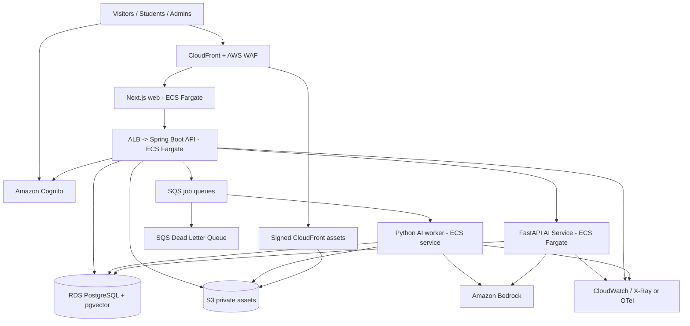

# System Architecture v1.1 (AWS, Spring Boot + Python)

## 1. Architecture decision records
- ADR-001: Polyglot monorepo: Next.js/TypeScript web, Java 21 Spring Boot modular-monolith LMS API, Python 3.12 FastAPI AI service and Python SQS worker. Rationale: transactional LMS domain in Java, AI experimentation/document tooling in Python. Deploy separate services; avoid further microservices.
- ADR-002: Production queue is SQS + DLQ (not BullMQ). Local queue transport uses LocalStack or a test double; production driver SQS. SQS delivers at least once: handlers MUST be idempotent.
- ADR-003: RDS PostgreSQL is system of record and pgvector search backend if extension supported by selected RDS PostgreSQL version. Provision a migration fallback to external vector store if not available; verify actual RDS extension version before provisioning.
- ADR-004: Amazon Bedrock SDK behind `AiModelGateway` for text generation and embeddings. Configure region/model IDs and IAM by environment; no assumed default model or quota. Consider Bedrock Knowledge Bases only in a measured subsequent ADR.
- ADR-005: Amazon Cognito managed user pools and JWT; Spring Security Resource Server verifies bearer tokens and maps Cognito subject to internal user. No home-built password/session crypto.
- ADR-006: No automatic publishing by AI; drafts require admin/editor review and publish transaction.
- ADR-007: Public website runs Next.js container on ECS Fargate in initial uniform operational model; CloudFront fronts static media and application routing as needed. Separate API Fargate service behind ALB. Evaluate static/hybrid frontend hosting as later optimization.

## 2. Runtime diagram

### Service trust boundaries
- Browser calls Java public API; it never receives internal AI service credentials or talks to Python directly.
- Java invokes Python via private endpoint using service identity (AWS IAM-based integration or mutually authenticated service token); short-lived scope claims include student ID, course version, allowed document scope, expiry, nonce and purpose.
- Python MUST re-check document version/status and ACL in its database queries, not merely trust arbitrary course IDs in headers.
- Java owns `users`, `courses`, `enrollments`, `course_versions`, `quizzes` and publication workflow. Python owns `ai_*`, `document_chunks`, `generation_*` and retrieval operations. Cross-domain schema changes require coordinated migrations; no general cross-service table writes.
- For async jobs, Java writes `outbox_events` in same transaction as `generation_requests` or `documents` and a dispatcher publishes to SQS; message has IDs/version, never raw document content.

### Networking
- VPC across >=2 AZs for production; web/API traffic controlled through ALB and security groups. Keep DB private; no DB public access.
- ECS tasks use least-privilege task roles; Secrets Manager for secrets, IAM for AWS service permissions.
- Use VPC endpoints where supported and economically beneficial; NAT gateway baseline costs must be evaluated in cost design.
- CloudFront+WAF for public ingress; CloudFront OAC for S3 origin, plus signed URLs/cookies for protected files. OAC alone does **not** authorize an individual learner.
- Never expose S3 object keys/permissions that allow long-lived sharing of protected materials.

## 3. Components and responsibilities
### Web (`apps/web`)
- Next.js server/client rendering; locale-aware public SEO routes; student/admin protected route UX.
- Web UI never makes authorization decisions by itself; Java API always enforces roles/course access.
- SSE reader with abort controller for AI streaming; keep tokens on server/secure managed auth flow.

### LMS API (`apps/api`, Java 21 / Spring Boot)
- `identity`: token verification, user sync, roles and policies.
- `catalog`: public course listing, localizations, publication status.
- `authoring`: draft/version management, modules/lessons, publish validation.
- `enrollment`: enrollment/entitlements; free only for MVP.
- `learning`: lesson access, progress tracking.
- `assessment`: quiz delivery and server-side scoring.
- `assets`: upload initiations, verification and authorized downloads.
- `ai-studio`: course generation requests and review actions.
- `tutor`: authenticate student, authorize course entitlement, issue signed scoped AI request and proxy SSE; retrieval and prompt assembly are owned by Python AI service.
- `audit`: append-only write audit events.

### AI service (`apps/ai-service`, Python 3.12 / FastAPI)
- Private, service-to-service only; exposed behind internal networking rather than the public edge.
- Validates short-lived signed scope claims issued by Java after entitlement checks, binds course version and document visibility to retrieval queries and re-checks DB ACLs.
- Exposes internal AI tutor streaming and generation status / health endpoints with OpenAPI contracts.
- Owns AI orchestration, model invocation, embeddings, citation validation and evaluation.

### Worker (`apps/ai-worker`, Python 3.12)
- `ingest-document`: verify file state and security scan, extract PDF/DOCX/PPTX text, preserve page/slide/section provenance; chunk+embed.
- `generate-outline`, `generate-lesson`, `generate-quiz`: structured output, Pydantic v2 / JSON Schema validation, retries and persistent artifacts.
- `reindex-document`: enforce document version, chunk tombstones and replacement.
- Progress saved in DB; queue messages reference job IDs, not megabytes of text.

### DB and Vector
- PostgreSQL transactions for publishing, attempts, enrollments, job states; `embedding vector(D)` dimension is fixed by chosen model and migration.
- Store embedding model name, dimension and index version. Changing embedding models requires re-embedding or a new index, not mixing vectors.
- Retrieval uses course/version/document state and backend-verified enrollment; tune HNSW/exact comparison with filtering and recall tests.

## 4. Critical runtime sequences
### Source upload
1. Admin invokes `POST /admin/documents/upload-intents` (metadata + size + MIME + expected hash).
2. API authorizes course editing and creates PENDING_UPLOAD document record plus bounded presigned S3 upload.
3. Browser uploads directly; API finalizes with HEAD/checksum/security scan. Non-verified files cannot process.
4. API transitions to UPLOADED and sends idempotent SQS ingestion job via transactional outbox (or equivalent delivery guarantee).
5. Worker extracts and persists normalized provenance; indexes. Status READY or FAILED with retry eligibility.

### AI course generation
1. Admin chooses READY, licensed source documents and generation parameters.
2. API captures immutable `generation_request`, dedupe key, source versions and queued job.
3. Worker retrieves only allowed sources and generates **structured** outline draft.
4. Admin edits/approves outline, requests lessons independently, then quizzes.
5. QA validation checks referential integrity, duplicate questions, options/answer coherence and citations.
6. Publish command checks all required content approved and creates immutable published version in one transaction.

### RAG tutor
1. Java API authenticates student, verifies active enrollment and course-version entitlement, then issues a short-lived scoped internal request to Python.
2. Python service validates the signed scope and independently enforces the allowlist in SQL; generate query embedding and retrieve only READY, approved chunks for the assigned published course version. If no matches, return evidence-limited response.
3. Optionally rerank, enforce context budget, assemble trusted instructions separately from untrusted document content.
4. Python streams Bedrock text to Java which proxies SSE to the client; validate generated citation identifiers against retrieved authorized chunk IDs.
5. Python persists AI answer/citations/usage under its domain tables, while Java persists user-facing conversation authorization/ownership; avoid leaking raw protected document text into logs.

## 5. API contracts (v1 examples)
- `GET /v1/courses?locale=vi&topic=ai&page=1&pageSize=12`
- `GET /v1/courses/:slug`
- `POST /v1/enrollments {courseId}`
- `GET /v1/me/courses` and `PUT /v1/lessons/:id/progress {status: COMPLETED}`
- `GET /v1/lessons/:id` (checks enrollment/version)
- `GET /v1/quizzes/:id` (no correct answer)
- `POST /v1/quizzes/:id/attempts {answers:[...]}`
- `POST /v1/admin/documents/upload-intents` and `POST /v1/admin/documents/:id/finalize`
- `POST /v1/admin/ai/generation-requests {courseDraftId, sourceDocumentIds, language, targetLevel, desiredModules}`
- `GET /v1/admin/ai/jobs/:jobId`
- `POST /v1/admin/courses/:id/publish {expectedDraftRevision}`
- `POST /v1/tutor/conversations` and `POST /v1/tutor/conversations/:id/messages` (SSE)
- `POST /v1/tutor/messages/:id/feedback {rating}`
All mutating endpoints: schema validation, consistent `problem+json` errors, audit actions; appropriate idempotency keys.

## 6. Security and privacy
- Cognito JWT audience/issuer/signature verification, server-enforced policies, course-level ACL and ownership.
- HTTPS; RDS encryption, S3 encryption, Secrets Manager, tight AWS IAM.
- Presigned upload key prefix per course/document, MIME sniffing and max file size; malware scan gate before ingestion.
- Limit upload count, model tokens, concurrent generation jobs and tutor messages per user/day; protect against model spam/cost attack.
- Structured prompt isolation: source documents are data, must never override policies; no AI-executed arbitrary tools.
- Copyright attestation and takedown/revoke path. No model training on user files by the application without consent.
- Safe SSE connection termination and concurrency limits; do not put private question/context in analytics events.
- Threat model includes IDOR, JWT confusion, CSRF for cookie-auth flows, S3 privilege escalation, indirect prompt injection, quiz answer disclosure, and vector cross-course leakage.

## 7. Reliability and operations
- Structured logs with requestId/jobId/courseId but no secrets/doc bodies.
- Dashboards: API latency/error, queue age/DLQ count, job success, ingestion throughput, Bedrock latency/token spend, RDS connections, storage size.
- CloudWatch alarms for API 5xx, queue age, DLQ >0, DB storage/connections, abnormal spend; cost budgets and AWS Cost Anomaly Detection.
- Workers are retry-safe; protect against out-of-order jobs with revision and document version preconditions.
- Database backups, staging restore drill, migration rollback guidance and immutable published content.
- P95 targets defined in PRD; run load tests with agreed traffic mix before beta.

## 8. Deployment/CI/CD
- IaC: AWS CDK TypeScript with `network`, `data`, `storage`, `identity`, `compute`, `observability` stacks and separate stage config.
- GitHub Actions or comparable CI: Next.js lint/typecheck, Java Gradle tests, Python Ruff/mypy/pytest, integration and contract tests, dependency/security audit, build and publish images to ECR.
- Deploy dev automatically after passing gates; production requires manual approval. Use controlled DB migration job before rolling ECS deployment; smoke tests and rollback.
- Environments `local`, `dev`, `staging`, `prod`. CI must not use long-lived cloud access keys; prefer OIDC federation.

## 9. Alternatives and tradeoffs
- **App Runner vs ECS:** App Runner can lower setup complexity for simple services. ECS/Fargate chosen for multiple coupled web/API/worker services and networking control, at potentially greater baseline expense.
- **SQS vs BullMQ:** SQS reduces Redis operations and AWS-managed delivery; less rich queue workflow UI. Job status/steps tracked in PostgreSQL.
- **pgvector vs Bedrock Knowledge Bases:** pgvector chosen for joins, course-version ACL and transparent citations; managed Knowledge Bases can reduce ingestion implementation complexity but requires careful tenancy/access control evaluation.
- **Bedrock vs external models:** Bedrock fits AWS governance, but chosen model availability, languages, throughput and quality must be benchmarked using actual AWS account/region.
- **Video:** Avoid self-managed transcoding in MVP; adopt protected hosted video or encoded file delivery and revisit MediaConvert after demand.

## 10. AWS references
- Fargate: https://docs.aws.amazon.com/AmazonECS/latest/developerguide/AWS_Fargate.html
- ECS ALB: https://docs.aws.amazon.com/AmazonECS/latest/developerguide/service-load-balancing.html
- CloudFront OAC: https://docs.aws.amazon.com/AmazonCloudFront/latest/DeveloperGuide/private-content-restricting-access-to-s3.html
- CloudFront signed content: https://docs.aws.amazon.com/AmazonCloudFront/latest/DeveloperGuide/private-content-overview.html
- Bedrock overview: https://aws.amazon.com/documentation-overview/bedrock/

## 11. Java ↔ Python internal contract (v1)
- `POST /internal/v1/tutor/stream` (private, streamed): Java sends `{requestId, conversationId, message, courseVersionId, lessonId?, locale, scopeToken}`; Python validates service identity and `scopeToken`, retrieves authorized chunks, streams typed events `delta`, `citation`, `usage`, `done` or `error`.
- `POST /internal/v1/ai/generation-requests/{id}/start`: internal orchestration only; preferable to publish job via transactional outbox + SQS and let Python worker fetch full job inputs.
- `GET /internal/v1/health/ready`: check dependencies with bounded timeouts.
- Contract source of truth: `contracts/openapi/lms-public.yaml` and `contracts/openapi/ai-internal.yaml`; Java and Python generate clients/validators and run contract tests in CI.
- Python must not trust user roles, student IDs or course IDs passed without a validated Java-issued scope. Java does not delegate publication decisions to AI.
- Java uses Spring Security OAuth2 resource server (Cognito JWKS), Spring Data JPA or JDBC, Flyway for LMS schema. Python uses SQLAlchemy 2, Alembic for AI-owned schema, Pydantic v2, pytest and Ruff.
- **Migration ownership:** Flyway manages Java domain tables; Alembic manages AI domain tables. Both use one RDS cluster initially with distinct PostgreSQL schemas (`lms`, `ai`) and different database roles. No cross-schema writes. Read-only cross-schema permission for authorized retrieval is narrowly scoped.
- **Chat streaming:** Java stays client-facing gateway to avoid exposing internal Python. It must propagate cancellation, handle timeout/backpressure and not buffer the entire response.
- **Data consistency:** immutable published course versions, request idempotency keys, outbox dispatcher, SQS at-least-once handling, state transitions with optimistic locking.
