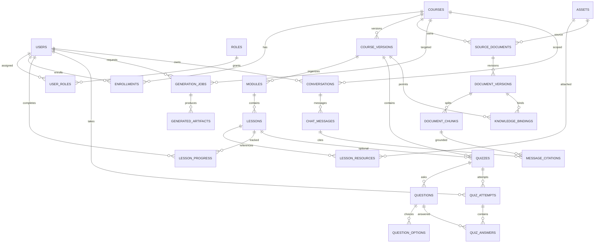

# Database ERD and Relational Design v1.0

Database: PostgreSQL 16+ candidate, final RDS version validated for `vector` extension. UUID primary keys, `created_at/updated_at` timestamptz, foreign keys with explicit `ON DELETE` semantics. Sensitive write operations audited.

## 1. Core ERD (Mermaid)


## 2. Table specification (important columns)
### Identity
- `users(id, cognito_sub UNIQUE NOT NULL, email CITEXT UNIQUE, preferred_locale, status)`
- `roles(id, code UNIQUE)` seeded ADMIN, EDITOR, STUDENT
- `user_roles(user_id FK, role_id FK, PRIMARY KEY(user_id,role_id))`
- `audit_events(id, actor_user_id, action, target_type, target_id, before_json, after_json, occurred_at)`; redact secrets/PII

### Catalog, content and learners
- `courses(id, slug UNIQUE, owner_user_id FK, status, visibility, pricing_model, current_published_version_id NULL, created_at)`
- `course_localizations(course_id, locale, title, description, PRIMARY KEY(course_id,locale))`
- `course_versions(id, course_id FK, version_number, state [DRAFT|IN_REVIEW|PUBLISHED|ARCHIVED], revision INT, language, level, published_at, immutable_after_publish BOOL, UNIQUE(course_id,version_number))`
- `modules(id, course_version_id FK, position INT, title, UNIQUE(course_version_id,position))`
- `lessons(id, module_id FK, position INT, type, title, body_jsonb, estimated_minutes, status, UNIQUE(module_id,position))`
- `assets(id, s3_key UNIQUE, mime, bytes, checksum, security_scan_status, owner_user_id, visibility, state)`
- `lesson_resources(id, lesson_id FK, asset_id FK, resource_type, position)`
- `enrollments(id, student_user_id FK, course_id FK, assigned_version_id FK, status, enrolled_at, UNIQUE(student_user_id,course_id))`
- `lesson_progress(id, student_user_id FK, lesson_id FK, status, completed_at, UNIQUE(student_user_id,lesson_id))`
- `topics(id, slug UNIQUE)` and `course_topics(course_id,topic_id)`

### Assessments
- `quizzes(id, course_version_id FK, lesson_id NULL FK, title, passing_score, max_attempts, state)`
- `questions(id, quiz_id FK, type [SINGLE_CHOICE|MULTIPLE_CHOICE], prompt, rationale, position, source_refs_jsonb)`
- `question_options(id, question_id FK, position, content, is_correct)` **never returned pre-submission**
- `quiz_attempts(id, quiz_id FK, student_user_id FK, started_at, submitted_at, score, passed, status)`
- `quiz_answers(id, attempt_id FK, question_id FK, selected_option_ids jsonb, awarded_points)`

### Documents, generation and RAG
- `source_documents(id, course_id FK, asset_id FK, rights_attested_by FK, visibility, state, name)`
- `document_versions(id, document_id FK, version_number, checksum, parser_version, status [PENDING|PROCESSING|READY|FAILED|REVOKED], UNIQUE(document_id,version_number))`
- `document_chunks(id, document_version_id FK, chunk_index, content, embedding VECTOR(D), embedding_model_id, token_count, page_start, page_end, section_path, content_hash, UNIQUE(document_version_id,chunk_index))`
- `knowledge_bindings(id, course_version_id FK, document_version_id FK, scope [COURSE|MODULE|LESSON], module_id NULL, lesson_id NULL, access_policy, is_active, UNIQUE(course_version_id,document_version_id,scope,module_id,lesson_id))` Note: PostgreSQL NULL semantics require additional partial unique indexes or NULLS NOT DISTINCT where supported.
- `generation_jobs(id, course_id FK, requested_by FK, job_type, status, input_fingerprint, source_version_ids jsonb, settings jsonb, model_id, prompt_version, attempts, error_code, token_input, token_output, started_at, finished_at, idempotency_key UNIQUE)`
- `generated_artifacts(id, generation_job_id FK, target_course_version_id FK, artifact_type [OUTLINE|LESSON|QUIZ], target_ref NULL, structured_content jsonb, source_refs jsonb, review_state [DRAFT|APPROVED|REJECTED], reviewed_by NULL, reviewed_at NULL)`
- `conversations(id, user_id FK, course_id FK, assigned_version_id FK, title, created_at)`
- `chat_messages(id, conversation_id FK, role, content, model_id, usage jsonb, created_at)`
- `message_citations(id, message_id FK, chunk_id FK, quoted_span, source_label, source_locator_jsonb)`
- `tutor_feedback(id, message_id FK, user_id FK, helpful BOOLEAN, created_at, UNIQUE(message_id,user_id))`
- `outbox_events(id, aggregate_type, aggregate_id, topic, payload jsonb, sent_at NULL, attempts)` ensures committed DB changes can be dispatched to SQS.

## 3. Constraints and integrity rules
- Course version publish is transactional; all required lessons, quizzes and sources approved and validated before state changes.
- Published `modules/lessons/quizzes` are logically immutable. Duplicate as a new version to edit. DB constraints/triggers or write-layer guards must enforce this.
- `enrollments.assigned_version_id` belongs to same `course_id`; verify with application and optional composite keys.
- `lesson_progress.student_user_id` must have active course enrollment to assigned version; validate in service.
- Course access eligibility is not inferred solely from `course_id` in chat request.
- A document can be REVOKED immediately; retrieval excludes it before physical vector cleanup.
- Revoking or replacing a document should keep historic citation snapshot metadata but disable source access based on current policy.
- Worker messages use IDs and optimistic revision checks to ignore stale retries; one job result cannot overwrite newer approved content.

## 4. Recommended indexes
```sql
-- SQL sketch; replace VECTOR_DIM with a *chosen integer* in migration, not literal text.
CREATE UNIQUE INDEX ON users (cognito_sub);
CREATE INDEX ON enrollments (student_user_id, status);
CREATE INDEX ON course_versions (course_id, state);
CREATE INDEX ON document_chunks (document_version_id);
CREATE INDEX ON knowledge_bindings (course_version_id, is_active);
CREATE INDEX ON chat_messages (conversation_id, created_at);
-- After profiling chosen pgvector operator class, model, filters and index size:
-- CREATE INDEX document_chunks_embedding_hnsw ON document_chunks
--   USING hnsw (embedding vector_cosine_ops);
```
Test exact vs approximate search on tenant/course constrained slices, including low-result scenarios; do not assume global HNSW + post-filter meets authorized recall target.

## 5. Retrieval query shape (conceptual)
```sql
-- Authorization is validated by API first; still join entitlement in retrieval.
SELECT dc.id, dc.content, dc.page_start, dc.section_path,
       dc.embedding <=> $2::vector AS distance
FROM document_chunks dc
JOIN document_versions dv ON dv.id = dc.document_version_id
JOIN source_documents sd ON sd.id = dv.document_id
JOIN knowledge_bindings kb ON kb.document_version_id = dv.id
JOIN enrollments e ON e.assigned_version_id = kb.course_version_id
WHERE e.student_user_id = $1
  AND e.status = 'ACTIVE'
  AND kb.is_active = TRUE
  AND dv.status = 'READY'
  AND sd.state = 'ACTIVE'
  AND sd.visibility IN ('ENROLLED', 'PUBLIC')
  AND e.course_id = $3
ORDER BY distance
LIMIT $4;
```
Additional joins/checks for scopes MODULE/LESSON, admin overrides, source policy and published content are required by actual query implementation. Query embeds are parameterized and dimension-checked.

## 6. Migration order
1. Users/roles/audit; 2. Courses/versions/localizations; 3. Modules/lessons/assets; 4. Enrollments/progress; 5. Quizzes/attempts; 6. Sources/document versions/chunks/knowledge bindings; 7. Generation and outbox; 8. Tutor and feedback; 9. Performance indexes.

## 7. Critical ERD review tests
- Cannot enroll twice; cannot complete another student's lesson via guessed ID.
- No quiz answer key leakage from GET endpoints.
- Publishing creates a stable version, not mutating previously published content.
- Course A user querying Course B chunks returns none, including via citations and direct download.
- Revoked document never appears in new retrieval even before background index cleanup.
- Reprocessing document creates a new version with no mixed embedding models.


## Ownership overlay for Spring Boot + Python (v1.1)
- Schema `lms` managed by **Flyway** in Java Spring Boot: identity, course, publication, enrollment, quiz, progress, asset metadata, audit, and transactional `outbox_events`.
- Schema `ai` managed by **Alembic** in Python: ingestion jobs, document versions/chunks/embeddings, generation requests/artifacts, tutor messages/citations and usage/evaluation.
- Existing ERD entity names are logical names; implementation must qualify tables and FK references with `lms.` or `ai.` and provide explicit migration dependency order.
- Cross-schema FKs are acceptable where supported and stable, but **never** grant cross-service write privileges. Python retrieval accesses approved `lms` entitlement/version metadata using read-only permissions or a dedicated entitlement projection refreshed from Java events. Public requests always pass Java authorization before internal AI routing.
- Use separate PostgreSQL roles (`lms_app`, `ai_app`) and migration roles. Test unauthorized cross-schema writes in CI.
- Do not dual-manage the same table or attempt both Flyway and Alembic on one migration history.
